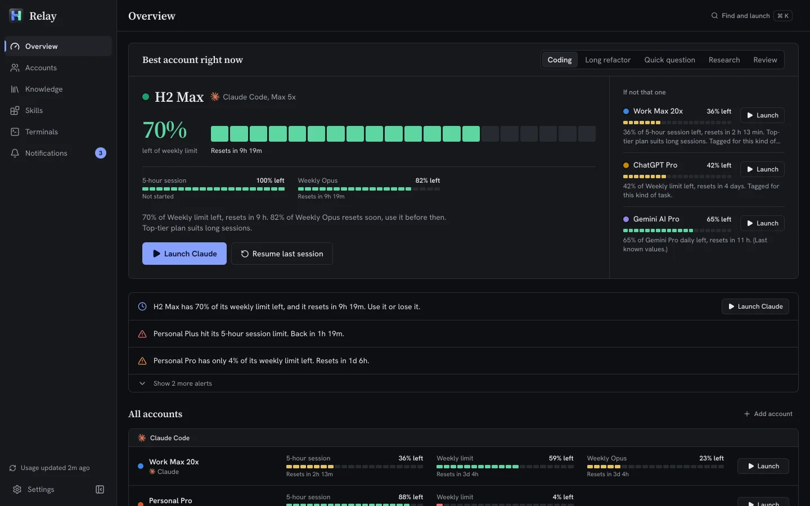
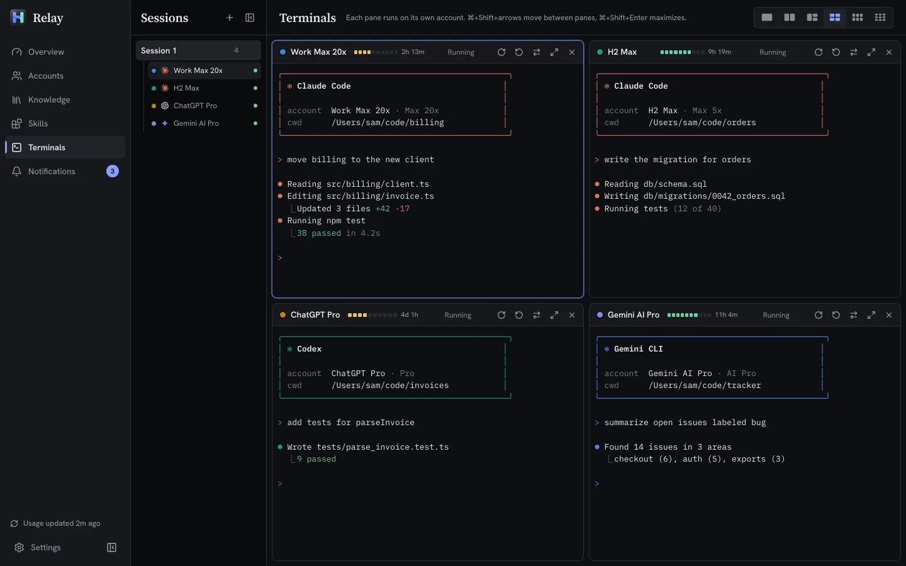
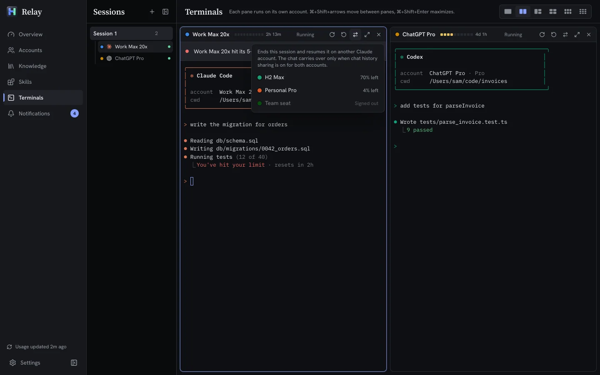
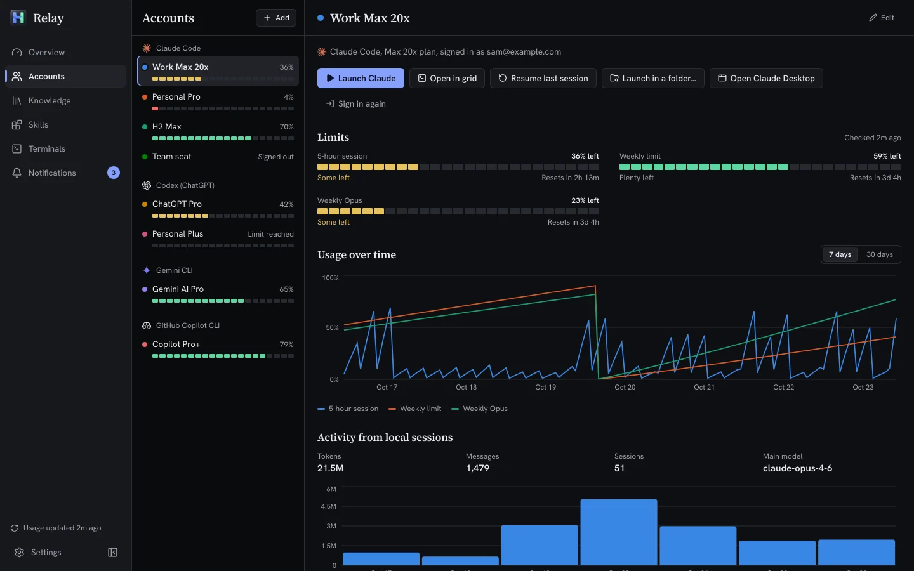
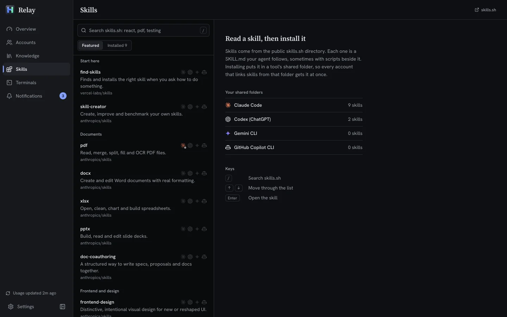

<p align="center"></p>

# Relay

**Your work, handed to the account that still has quota.** All your AI subscriptions in one place. See how much of every limit you have left, get told before you hit one (or before unused quota resets), and launch Claude Code, Codex, Gemini CLI or Copilot CLI with the account you pick, in one click.

Runs on **Windows, macOS and Linux**. Free and open source (MIT). Everything stays on your computer.

[Download](https://github.com/CristiMachine25/relay/releases/latest) · [Website](https://cristimachine25.github.io/relay/) · [Report a bug](https://github.com/CristiMachine25/relay/issues)

<picture>
  <source media="(prefers-color-scheme: light)" srcset="docs/screenshots/overview-light.webp">
  
</picture>

> [!WARNING]
> **Early software, expect bugs.** Relay is a young open-source project (v0.2) built and tested by one person. It almost certainly has bugs, and the usage numbers come from provider endpoints that can change or break without notice. Treat what it shows as a guide, not a guarantee. The installers are **not code-signed**, so Windows and macOS will warn you the first time you open it (see [Install](#install)). It is provided as is, with no warranty: see [Disclaimer](#disclaimer).

## Why

If you pay for more than one AI plan (two Claude Max accounts, ChatGPT Pro, Gemini, Copilot...), you know the routine: hit a limit, log out, log in to another account, forget which one still has quota, and watch a weekly limit reset while half of it was never used. Relay keeps every account signed in side by side and tells you which one to use next.

## Features

- **Finds your accounts.** Detects installed CLIs and existing config folders, including side-by-side ones like `~/.claude-work`.
- **Every account stays signed in.** Each account gets its own config home (`CLAUDE_CONFIG_DIR`, `CODEX_HOME`, ...), so switching never means logging out.
- **Live limits.** 5-hour session, weekly, weekly Opus, Codex primary/secondary windows, Gemini model quotas, Copilot premium requests, with reset countdowns and history charts.
- **Notifications.** Nearly exhausted, limit reached, limit reset, and "use it or lose it" when lots of a weekly or monthly limit (Claude, Codex, Copilot) is about to reset unused. Gemini's daily quotas get no such reminder.
- **Recommendations.** Pick a task type (coding, long refactor, quick question, research, review) and get the best account to use right now.
- **One-click launch.** Opens your terminal with the right account, or resumes your last session. Desktop apps too, where they support it.
- **Launcher.** Press Ctrl/Cmd+K, type an account or screen name, press Enter. Keys `1` to `7` jump between screens.
- **Permission modes.** Pick per tool how every CLI starts, on every account: ask as usual, accept edits, plan, or bypass permissions (Claude Code), auto or bypass (Codex), auto edit or YOLO (Gemini), allow all tools (Copilot).
- **Sharing you control.** Per account, choose what to share with your main setup: skills, plugins, agents and commands, instructions, MCP servers, settings, chat history. Credentials are never shared.
- **Shared knowledge.** Each tool gets one shared profile for skills, agents, instructions, plugins and settings, and every account links to it, so all your accounts work the same way. The Knowledge screen shows what is in it.
- **Skills from skills.sh.** Browse featured skills or search the public skills.sh directory, read a skill's SKILL.md, and install it for Claude Code, Codex, Gemini CLI or Copilot in one step. It goes into each tool's shared folder, downloaded from the skill's GitHub repository at a single commit, and nothing already there is overwritten.
- **Terminal grid.** Run up to nine AI CLIs side by side in one window, each pane on its own account with its own meter. When one hits its limit, continue the same chat on another account in one click. Keep several sessions, each with its own layout, in a collapsible list beside the grid; hidden sessions keep running.
- **Move to a new computer.** Export your setup (accounts, skills, preferences) to a `.relay` file (older `.agenthub` files still import) and import it on Windows, macOS or Linux. Sign-ins are optional and encrypted with a passphrase you choose. Import only adds: nothing already on the computer is replaced.
- **Tray menu** for quick launches without opening the window. Relay can start at login, hidden in the tray.

See [docs/PLAN.md](docs/PLAN.md) for what has shipped and what is next.

## Screenshots

| Terminal grid: one account per pane | Hit a limit, continue on another account |
|---|---|
|  |  |
| **Accounts: every limit and reset time** | **Skills from skills.sh** |
|  |  |

The screenshots use the built-in demo data, not real accounts.

## Supported tools

| Tool | Accounts | Live limits | Launch |
|---|---|---|---|
| Claude Code (+ Claude Desktop) | yes | yes | CLI, desktop |
| Codex CLI (ChatGPT plans) | yes | yes | CLI |
| Gemini CLI | yes | yes | CLI |
| GitHub Copilot CLI | yes | premium requests | CLI |

More are planned: Cursor, Antigravity, Kiro, Amp, OpenRouter.

## Privacy

- No servers, no telemetry, no account with us.
- With **live usage** on, Relay reads each account's own login token from your disk and sends it only to that provider's own servers: its usage endpoint, its account profile when usage is refused, and its sign-in renewal. Turn it off in Settings to use local session logs only.
- Relay never copies or links credential files between accounts.

## Install

Download the file for your system from [Releases](https://github.com/CristiMachine25/relay/releases/latest):

| System | File |
|---|---|
| Windows 10/11 | `Relay_<version>_x64-setup.exe` (or the `.msi`) |
| macOS, Apple Silicon (M1 and later) | `Relay_<version>_aarch64.dmg` |
| macOS, Intel | `Relay_<version>_amd64.dmg` |
| Linux | `.AppImage` (any distro), `.deb` (Debian, Ubuntu) or `.rpm` (Fedora) |

### "Unknown developer" warnings

Relay's installers are not code-signed or notarized yet (that costs money and paperwork this project doesn't have yet). Your system will warn you once; this is expected. Only download Relay from this repository's Releases page.

- **Windows:** SmartScreen shows "Windows protected your PC". Click **More info**, then **Run anyway**.
- **macOS:** the first time you open Relay, macOS says it can't verify the developer. Open **System Settings > Privacy & Security**, scroll down and click **Open Anyway**, then confirm. (Or run `xattr -dr com.apple.quarantine /Applications/Relay.app` in Terminal.)
- **Linux:** make the AppImage executable first: `chmod +x Relay_*.AppImage`.

Relay was called Agent Hub before. Data folders keep the old internal id (`dev.switchyard.app`) so upgrades keep your setup: accounts, settings and history carry over.

## Build from source

Prerequisites: Node.js 22.12+, Rust (stable), and the [Tauri prerequisites](https://v2.tauri.app/start/prerequisites/) for your OS.

```bash
npm install
npm run app:dev     # run the desktop app with hot reload
npm run app:build   # build installers into src-tauri/target/release/bundle
npm run dev         # UI only, in a browser, with mock data
```

## Contributing

Issues and pull requests are welcome. Adding a provider takes an adapter plus a few tables on both sides; the compiler points at most of them once the new id exists:

- **Rust:** implement the `ProviderAdapter` trait in a new file in `src-tauri/src/providers/` and register it in `providers::all()` (`providers/mod.rs`, which also maps permission modes to CLI flags). Add the id to `ProviderId` and `PermissionModes` in `src-tauri/src/model.rs`, its short name in `ProviderId::name` (`model.rs`), and, if its plans use tier words the recommender doesn't know yet, those words to `tier` in `recommend.rs` (mirrored in `src/lib/recommend.ts`). Return failures as a `FetchError` (`providers/mod.rs`) of the right kind, so being offline never reads as signed out.
- **Contract check:** `cargo test` checks `src/shared/__fixtures__/serde.ts` against the Rust types. After changing a shape, a command, an event or an enum (a new `ProviderId` also goes in the `variants!` lists in `model.rs`), regenerate it with `cd src-tauri && UPDATE_SERDE_FIXTURE=1 cargo test serde_fixture`, then run `npm run typecheck` to see what `types.ts` is missing. Rust sends a `None` as `null`, so an `Option` field the UI receives is typed `?: T | null`; the fixture lists each one. When you add a type the UI receives, add an `f.nulls(...)` line for it in `contract_tests`. Events are types in `src-tauri/src/events.rs`: add a new one to the `events!` list there, send it with `events::emit`, and write a value of it with `f.event(...)` in `contract_tests`. A test fails on any other way of emitting.
- **UI:** add the id to `ProviderId` and `PermissionModes` in `src/shared/types.ts`, then to `PROVIDER_ORDER`/`PROVIDER_META` (`src/lib/providers.ts`), `PLANS`/`DEFAULT_PLAN` (`src/lib/plans.ts`), the logo (`LOGO_PATHS` in `src/components/ui.tsx`), the permission mode options (`src/screens/Knowledge.tsx`) and the browser-preview data (`src/mock/`).

## Disclaimer

Relay is free, open-source software provided **as is, without warranty of any kind** (see the [MIT license](LICENSE)). It is early-stage and very likely has bugs. You use it at your own risk; the author is not liable for lost work, missed limits, account problems or any other damage.

Relay is an independent project, not affiliated with or endorsed by Anthropic, OpenAI, Google or GitHub. Product names are used only to say which tools it works with. It uses each tool's own login and its documented or observed usage endpoints, which can change without notice. Following each provider's terms of service, including how you use multiple accounts, is your responsibility.

Found a bug? Please [open an issue](https://github.com/CristiMachine25/relay/issues). For a security problem, please don't post details publicly; use GitHub's private [security advisory](https://github.com/CristiMachine25/relay/security/advisories/new) form instead.

## License

[MIT](LICENSE)
